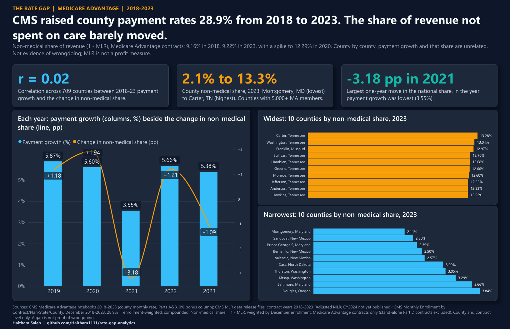
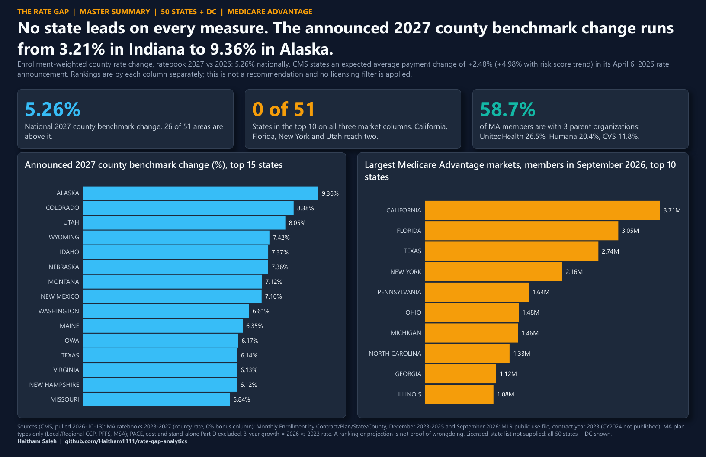
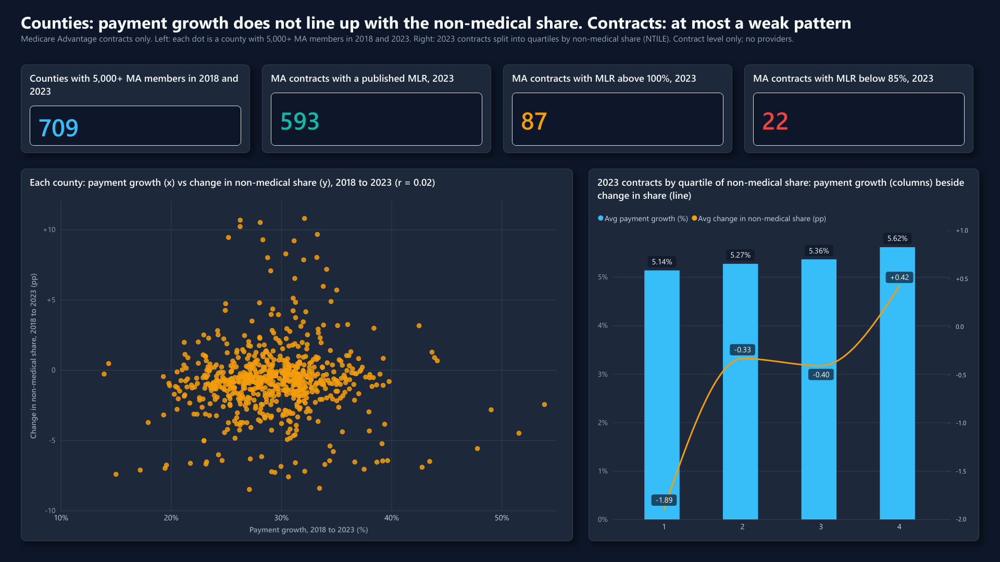
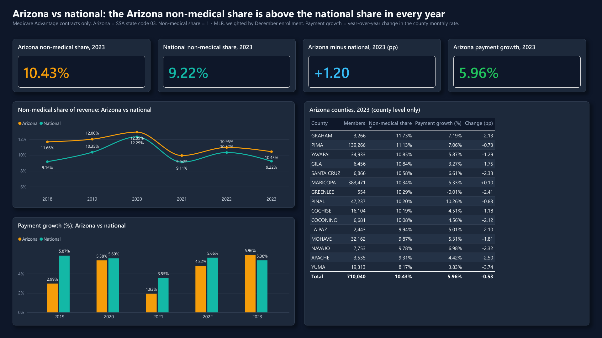

# The Rate Gap

**When CMS raises what it pays Medicare Advantage plans, does the share of revenue spent on medical care change? County and contract analysis of CMS public data, 2018-2023, in SQL Server, Python and Power BI.**



Print-ready: [`powerbi/poster-11x17.pdf`](powerbi/poster-11x17.pdf) (17 x 11 in).

## Findings

Scope: Medicare Advantage contracts only. Non-medical share = 1 - MLR, weighted by December enrollment. All numbers below come from the SQL results in [`sql/results/`](sql/results/).

1. **Payment rates rose 28.9% from 2018 to 2023 (enrollment-weighted, compounded). The non-medical share barely moved: 9.16% in 2018, 9.22% in 2023 (+0.06 pp).** County payment growth was 5.87%, 5.60%, 3.55%, 5.66% and 5.38% in 2019 to 2023. The share did move year to year: +1.18, +1.94, -3.18, +1.21 and -1.09 pp, peaking at 12.29% in 2020. 2021 had both the lowest payment growth and the biggest drop in share; with five yearly points that pattern is not tested here. In 2020, 118 MA contracts reported an MLR under 85%, against 21 to 49 in every other year.
2. **County by county, payment growth and the change in non-medical share are unrelated.** Across the 709 counties with 5,000+ MA members in 2018 and 2023, payment rose 29.3% on average (range 13.9% to 53.9%) while the share changed -0.72 pp on average (range -8.5 to +10.8 pp). Correlation r = 0.02. Contracts show at most a weak pattern: split into quartiles by 2023 non-medical share, average payment growth is 5.14%, 5.27%, 5.36% and 5.62%, while the average change in share is -1.89, -0.33, -0.40 and +0.42 pp (quartiles are grouped by the 2023 share level, not by its change).
3. **The share differs far more between places than over time.** In 2023 the widest county is Carter, TN at 13.28% and the narrowest is Montgomery, MD at 2.11% (counties with 5,000+ MA members). Nine of the ten widest are in Tennessee, the tenth in Missouri; the narrowest ten are in Maryland (3), New Mexico (3), Washington (2), North Dakota (1) and Oregon (1). Arizona sits above the national share in every year: 10.43% vs 9.22% in 2023 (+1.20 pp).

**This is not a surprise result.** The data shows no pass-through signal in either direction. It is not evidence of wrongdoing: a county value reflects which contracts serve it, and MLR is a regulatory ratio, not a profit measure. See [`reports/methodology-and-limits.md`](reports/methodology-and-limits.md).

## Master extension: newest data, by state (added 2026-10-13)

Built on top of the project above; nothing in v1 was changed or replaced. It adds the newest CMS releases (county rates through the 2027 ratebook, enrollment through September 2026) and a 50-state + DC view for agents and upline deciding where to focus. Non-medical share stays at contract year 2023 because CMS had not published a newer MLR file.



Print-ready: [`powerbi/rate-gap-master-summary-11x17.pdf`](powerbi/rate-gap-master-summary-11x17.pdf). Report file: [`powerbi/rate-gap-master-40-state.pbix`](powerbi/rate-gap-master-40-state.pbix) (summary page, state scorecard with a state slicer, 2027 outlook).

**Five findings** (each has a SQL query and a "what this does NOT show" line in [`reports/master-findings.md`](reports/master-findings.md)):

1. **The announced 2027 county benchmark change runs from 3.21% (Indiana) to 9.36% (Alaska); 5.26% nationally, 26 of the 51 areas above it.** This is the county rate file. CMS's expected average payment change is +2.48%, +4.98% with risk score trend (April 6, 2026).
2. **County rates rose 8.69% in 2026, 3.66 times the 2024-25 average** (2.32% in 2024, 2.43% in 2025). The 2027 trend projection is 4.48%, against 5.26% announced.
3. **No state clearly leads.** None of the 51 areas is in the top 10 on all three of MA members, 3-year payment growth and 2027 announced change. California, Florida, New York and Utah reach two. The 10 largest states hold 56.7% of 34,871,342 MA members (September 2026).
4. **Three parent organizations hold 58.7% of MA members:** UnitedHealth 26.5%, Humana 20.4%, CVS 11.8%. In 42 of 51 areas the largest parent holds 30% or more.
5. **State non-medical share and payment growth are unrelated (r = 0.032 across 51 areas),** matching v1 at county level. The 2023 share runs from 2.24% (North Dakota) to 12.17% (Tennessee).

**Not decided here:** which states are "good". Rankings are by each column alone and nothing is combined. The licensed-state list was not supplied, so all 50 states + DC are built and `dbo.dim_state_licence.licensed` is empty for you to fill in. Projections are labeled and are not forecasts or evidence of wrongdoing.

| New file | What it is |
|---|---|
| [`python/03_pull_cms_latest.py`](python/03_pull_cms_latest.py), [`04_validate_latest.py`](python/04_validate_latest.py) | Pull the newest CMS files; recount them (17 PASS / 0 FAIL) |
| [`sql/00b_setup_latest_data.sql`](sql/00b_setup_latest_data.sql) | New tables and views, loaded beside v1 |
| [`sql/09_state_scorecard.sql`](sql/09_state_scorecard.sql) | One row per state, newest year, with a rank for each column |
| [`sql/10_state_outlook_2027.sql`](sql/10_state_outlook_2027.sql) | 2027 announced change, trailing trend and labeled projection |
| [`sql/11_plan_mix_by_state.sql`](sql/11_plan_mix_by_state.sql) | Top 5 parent organizations per state |
| [`sql/12_five_findings.sql`](sql/12_five_findings.sql) | The queries behind the five findings |
| [`reports/master-findings.md`](reports/master-findings.md) | Findings, source register, ranking method |
| [`reports/dax-measures-master.md`](reports/dax-measures-master.md) | Nine new measures and their BLANK tests |

To reproduce: run `python python/03_pull_cms_latest.py` and `04_validate_latest.py`, then `sqlcmd -S .\SQLEXPRESS -C -i sql\00b_setup_latest_data.sql`, then `sql\09` to `sql\12`. Source register and projection method: [`reports/methodology-and-limits.md`](reports/methodology-and-limits.md).

## Tech stack

SQL Server Express (T-SQL: views, window functions, NTILE, PERCENTILE_CONT), Python 3 with pandas, Power BI Desktop (DAX, PBIR format, dark theme).

## Folder map

```
rate-gap-analytics/
├── README.md
├── data/
│   ├── README.md                 sources, file names, columns, vintage
│   └── stage/                    staged CSVs written by python/01_pull_cms.py
├── python/
│   ├── 01_pull_cms.py            download the CMS files and stage clean CSVs
│   ├── 02_validate.py            recount raw files vs staged CSVs (42 checks)
│   └── validation_output.txt     42 PASS / 0 FAIL
├── sql/
│   ├── 00_setup_database.sql     database, staging tables, views
│   ├── 01 ... 08_*.sql           the eight queries
│   └── results/                  SSMS screenshots (.png) and text output (.txt)
├── powerbi/
│   ├── rate-gap-dashboard.pbix   3 pages, 20 measures, reads .\SQLEXPRESS / Rate_Gap
│   ├── poster-11x17.pdf          the poster, 17 x 11 in landscape
│   ├── rate-gap-theme-dark.json
│   └── build/                    scripts that built the model and pages
├── reports/
│   ├── dax-measures.md           all 20 measures, BLANK behavior, test results
│   ├── dax-blank-tests-output.txt
│   └── methodology-and-limits.md
└── screenshots/                  the three report pages
```

## SQL proofs

Each query was run in SSMS against the loaded database. Click a link for the screenshot; the same output is saved as text beside it.

| Query | What it answers | Result |
|---|---|---|
| [`00_setup_database.sql`](sql/00_setup_database.sql) | Staging tables, load, and the views every query reads | 19,472 rate rows, 3,198 MLR rows, 425,613 contract x county rows, 184,918 fact rows |
| [`01_payment_growth_by_year.sql`](sql/01_payment_growth_by_year.sql) | County payment growth by year | [png](sql/results/01_payment_growth_by_year.png) |
| [`02_mlr_by_year.sql`](sql/02_mlr_by_year.sql) | MLR by year, contracts over 100% and under 85% | [png](sql/results/02_mlr_by_year.png) |
| [`03_nonmed_share_by_county.sql`](sql/03_nonmed_share_by_county.sql) | Non-medical share by county, 2023; Arizona counties | [png](sql/results/03_nonmed_share_by_county.png) |
| [`04_top10_widest_narrowest.sql`](sql/04_top10_widest_narrowest.sql) | Ten widest and ten narrowest counties | [png](sql/results/04_top10_widest_narrowest.png) |
| [`05_contract_distribution_ntile.sql`](sql/05_contract_distribution_ntile.sql) | 2023 contracts in quartiles (NTILE) | [png](sql/results/05_contract_distribution_ntile.png) |
| [`06_yoy_trend.sql`](sql/06_yoy_trend.sql) | Year-over-year trend; county correlation | [png](sql/results/06_yoy_trend.png) |
| [`07_az_vs_national.sql`](sql/07_az_vs_national.sql) | Arizona vs national | [png](sql/results/07_az_vs_national.png) |
| [`08_reconciliation.sql`](sql/08_reconciliation.sql) | Database totals tie to the raw CMS files; enrollment funnel | [png](sql/results/08_reconciliation.png) |

Python validation: **42 PASS / 0 FAIL of 42 checks** ([`python/validation_output.txt`](python/validation_output.txt)). It recounts every raw file a different way than the loader and compares row counts and totals.

## Dashboard pages

**Counties and contracts**



**Arizona vs national**



The 20 DAX measures, with BLANK behavior and edge-case test results, are in [`reports/dax-measures.md`](reports/dax-measures.md).

## Data sources

All public CMS data, pulled 2026-10-13. Exact file names, columns and newest years are in [`data/README.md`](data/README.md).

| Data | Source |
|---|---|
| County monthly payment rate (benchmark), 2018-2023 | [CMS Medicare Advantage Rates & Statistics: Ratebooks and Supporting Data](https://www.cms.gov/medicare/payment/medicare-advantage-rates-statistics/ratebooks-supporting-data) |
| Medical Loss Ratio by contract, contract years 2018-2023 | [CMS Medical Loss Ratio](https://www.cms.gov/medicare/health-drug-plans/medical-loss-ratio) |
| Contract x county enrollment, December 2018-2023 | [CMS Monthly Enrollment by Contract/Plan/State/County](https://www.cms.gov/data-research/statistics-trends-and-reports/medicare-advantagepart-d-contract-and-enrollment-data/monthly-enrollment-contract/plan/state/county) |

## How to reproduce

Needs SQL Server Express (`.\SQLEXPRESS`, Windows authentication), Python 3 with pandas and openpyxl, and Power BI Desktop.

1. `python python/01_pull_cms.py` downloads about 450 MB of CMS files into `C:\Users\Public\rate_gap\raw\` and writes the staged CSVs to `C:\Users\Public\rate_gap\stage\` (SQL Server cannot read from Downloads). The same staged files are in [`data/stage/`](data/stage/).
2. `python python/02_validate.py` and check for `OVERALL: PASS`.
3. `sqlcmd -S .\SQLEXPRESS -C -i sql\00_setup_database.sql`, then run `sql\01` to `sql\08` against `Rate_Gap`.
4. Open `powerbi/rate-gap-dashboard.pbix` and refresh. To rebuild it from scratch, see `powerbi/build/`.

## Limitations

- **A county value is a contract-mix value.** CMS publishes MLR per contract. Each contract's MLR is applied to every county it serves, so a county share is the enrollment-weighted mix of the contracts there.
- **MLR is a regulatory ratio.** It uses CMS rules (credibility adjustments, allowed cost categories). It is not a profit or margin measure.
- **Medicare Advantage only.** Stand-alone Part D contracts are excluded. Employer group plans stay inside their contracts and are not separated.
- **Payment rate = the 0% bonus column** of the county rate file, used as the base benchmark. That reading of the column is an assumption.
- **Newest MLR is contract year 2023.** CMS had not published a CY2024 file when this was pulled. Ratebooks exist through 2027 but have no MLR to match.
- **Enrollment cells of 10 or fewer are suppressed** by CMS and are not in the weights.
- **MLR above 100% is real data.** 87 of 593 MA contracts in 2023 report one, so contract non-medical shares can be negative.
- Counties and contracts only. No individual providers are named or listed anywhere.

## Author

Built by **Haitham Saleh**, a licensed Medicare analyst moving into healthcare data analytics. Microsoft Certified: Power BI Data Analyst Associate (PL-300).
